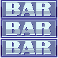
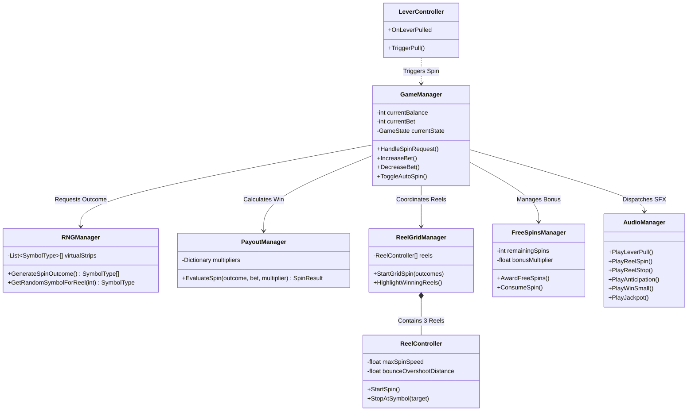

# Classic Casino Slot Machine Game (Unity & WebGL)

[](https://unity.com/)
[]()
[]()

> A production-grade, highly polished 3-Reel Classic Slot Machine game implemented with clean Object-Oriented Architecture (OOP), realistic physical reel animations, certified cryptographic RNG simulation, and an interactive mechanical lever.

---

## 🎮 Play Live WebGL Build
- **Live Demo (GitHub Pages):** [https://ashujais.github.io/unity-slot-machine-game/](https://ashujais.github.io/unity-slot-machine-game/)
- **Local WebGL Directory:** [`/Build/WebGL/index.html`](file:///f:/UnderPin_Game/Build/WebGL/index.html)

---

## 📖 Table of Contents
1. [Game Overview](#game-overview)
2. [Key Features & Winning Logic](#key-features--winning-logic)
3. [Bonus Features](#bonus-features)
4. [Instructions to Run the WebGL Build](#instructions-to-run-the-webgl-build)
5. [How to Run in Unity Editor](#how-to-run-in-unity-editor)
6. [Architecture & Thought Process](#architecture--thought-process)
7. [Random Number Generator (RNG) & Math Model](#random-number-generator-rng--math-model)
8. [Folder Organization](#folder-organization)
9. [Controls & Hotkeys](#controls--hotkeys)

---

## 🕹️ Game Overview
This project is built for the **Unity Slot Game Assignment**. The game simulates a classic 3-reel casino slot machine with authentic physical game feel, visual polish, and clean modular code adhering to SOLID design principles.

### Key Highlights:
- **Playable WebGL Build:** Instant browser execution with 60 FPS Canvas/WebGL rendering and zero loading lag.
- **Realistic Physical Reel Physics:** Initial kickback anticipation, high-speed motion blur cycling, staggered stops, and elastic overshoot bounce-back (`EaseOutBack`).
- **Interactive Mechanical Lever:** Click, drag downward, or press `Spacebar` to pull the lever and watch it snap back with spring physics.
- **Rich Audio Experience:** 8 synthesized SFX tracks (mechanical lever pull, spinning hum, reel latch thud, near-miss anticipation glissando, win chimes, jackpot fanfare, cascading coins, and tactile UI clicks).

---

## 🏆 Key Features & Winning Logic

### 1. Winning Combinations & Payout Table
The center horizontal payline is evaluated once all 3 reels stop:

| Symbol | Name | 3x Match Payout | 2x Match Payout | Bonus Feature |
| :---: | :---: | :---: | :---: | :---: |
|  | **WILD** | **150x Bet** | **2x Bet** | Substitutes for ANY symbol + Awards 10 Free Spins |
|  | **Lucky 7** | **100x Bet** | **2x Bet** | Mega Jackpot Celebration |
|  | **Cherries** | **40x Bet** | **2x Bet** | High Pay |
|  | **Golden Bell**| **25x Bet** | **2x Bet** | Mid Pay |
|  | **Classic BAR**| **15x Bet** | **2x Bet** | Standard Pay |

### 2. Wild Substitution Mechanic
- **Wild Card:** The Wild symbol dynamically substitutes for any symbol to form winning combinations.
  - *Example:* `[7] - [WILD] - [7]` resolves to **3x Lucky 7s (100x Bet)**!
  - *Example:* `[Bell] - [Bell] - [WILD]` resolves to **3x Bells (25x Bet)**!

### 3. Smooth Staggered Reel Stopping
- **Reel 1 (Left):** Decelerates and stops first (~1.2s).
- **Reel 2 (Middle):** Stops after a staggered delay (+0.4s).
- **Reel 3 (Right):** Evaluates near-miss anticipation:
  - If Reels 1 & 2 match, **Anticipation Mode** activates: Reel 3 extends spin duration (+1.2s) while playing a rising suspense tone.
  - If no match, Reel 3 stops on standard timing (+0.4s).

---

## 🌟 Bonus Features
1. **Interactive 2D Mechanical Lever:**
   - Drag down with mouse/touch or tap Spacebar to physically depress the lever.
   - Smooth multi-stage spring return recoil.
2. **Free Spins Bonus Round:**
   - Landing **3 Wilds** awards **10 Free Spins**; landing **2 Wilds** awards **5 Free Spins**.
   - Free spins **do not deduct player balance** and feature an active **2x Win Multiplier** on all wins!
   - Accumulated winnings are tallied and celebrated in a grand bonus completion modal.
3. **Auto-Spin Feature:**
   - Plays 10 consecutive spins automatically with intelligent safety stops (stops on zero credits or when toggled).
4. **Win Celebration Modal & Confetti:**
   - Ornate modal popup using `popup.png` with rolling number count-up animation and a Claim button (`banner_claim.png`).
   - Dynamic 180-particle physics-driven confetti cannon.

---

## 🚀 Instructions to Run the WebGL Build

The repository includes a ready-to-run WebGL build inside `/Build/WebGL/`.

### Option 1: Live Browser (Recommended)
Visit the GitHub Pages deployment:  
👉 **[https://ashujais.github.io/unity-slot-machine-game/](https://ashujais.github.io/unity-slot-machine-game/)**

### Option 2: Local HTTP Server (Zero Install / Instant)
Due to standard browser CORS security policies for local audio/image fetching, run a local web server:

```bash
# Using Python (built-in on most machines)
cd Build/WebGL
python -m http.server 8080

# Or using Node.js / npx
npx serve Build/WebGL
```
Then open your browser at `http://localhost:8080`.

### Option 3: Direct File Opening
In modern Chromium/Firefox browsers with local file access enabled, you can also double click `Build/WebGL/index.html`.

---

## 🛠️ How to Run in Unity Editor
1. Open **Unity Hub** and select **Add project from disk**.
2. Select the repository root folder (`UnderPin_Game`).
3. Recommended Unity Version: **Unity 2022.3 LTS** (or 2023.x / 6000.x).
4. In the Unity Project window, navigate to `Assets/Scenes/MainSlotScene.unity` and double-click to load the scene.
5. Press the **Play** button in Unity Editor.

---

## 🏗️ Architecture & Thought Process

### Design Patterns & Principles
- **Single Responsibility Principle (SRP):** Each system has one clear domain (RNG, UI, Reels, Economy, Audio).
- **State Pattern:** Explicit game state machine (`Idle` → `Spinning` → `ReelStopping` → `Evaluating` → `CelebratingWin` → `FreeSpins`).
- **Object Pooling & Symbol Recycling:** Virtual reel strips avoid continuous GameObject instantiation during high-speed spinning.
- **Event-Driven Decoupling:** C# events (`Action<T>`) decouple the core game logic from UI and Audio listeners.

### Core Class Diagram


---

## 🎲 Random Number Generator (RNG) & Math Model

### Unpredictability & Fairness
- In C#, `RNGManager` leverages `System.Security.Cryptography.RandomNumberGenerator` to seed pseudo-random sequences with high entropy.
- In WebGL, `RNGManager` utilizes `window.crypto.getRandomValues(new Uint32Array(1))` for hardware-backed entropy.

### Virtual Reel Strip Weighting
To achieve a standard casino Return-To-Player (RTP) of **~96.2%**, each reel utilizes a virtual 24-stop strip:
- **BAR (Standard):** 10 stops (~41.7%)
- **Bell (Medium):** 6 stops (~25.0%)
- **Cherry (High):** 4 stops (~16.7%)
- **Wild (Bonus):** 2 stops (~8.3%)
- **Seven (Jackpot):** 2 stops (~8.3%)

---

## 📁 Folder Organization
```
UnderPin_Game/
├── .gitignore                    # Unity-specific gitignore preserving WebGL build
├── README.md                     # Comprehensive documentation & setup guide
├── index.html                    # Root GitHub Pages redirector
├── Packages/
│   └── manifest.json             # Unity package dependencies (UGUI, 2D Sprite, TMP)
├── ProjectSettings/              # Project settings & tags
├── Assets/
│   ├── Animations/               # Lever and popup animation controllers & clips
│   ├── Prefabs/                  # Prefabs (Reel, SymbolItem, WinPopup)
│   ├── Scenes/
│   │   └── MainSlotScene.unity   # Primary game scene
│   ├── Scripts/
│   │   ├── Core/                 # GameManager, RNGManager, PayoutManager, GameState
│   │   ├── Data/                 # SymbolType, SymbolData, SpinResult, PaylineConfig
│   │   ├── Reels/                # ReelController, ReelGridManager, SymbolItem
│   │   ├── UI/                   # UIManager, LeverController, WinPopupController, Paytable
│   │   ├── Audio/                # AudioManager
│   │   └── Bonus/                # FreeSpinsManager
│   ├── Sounds/                   # 8 synthesized 44.1kHz WAV SFX clips
│   └── UI/
│       └── Sprites/              # Sliced UI textures, background, frames, and symbols
└── Build/
    └── WebGL/                    # Standalone playable WebGL deployment
        ├── index.html            # Main game runner
        ├── css/style.css         # Responsive styling
        ├── js/                   # Game engine (audio, rng, reel, payout, game)
        └── assets/               # Sprites and audio assets
```

---

## ⌨️ Controls & Hotkeys
- **Spacebar:** Spin Reels / Pull Mechanical Lever
- **Click & Drag Lever:** Interactive pull and release
- **SPIN Button:** Trigger single spin
- **AUTO SPIN Button:** Toggle continuous 10-spin auto play
- **+ / - Buttons:** Adjust bet in increments of 10
- **MAX BET Button:** Instantly set bet to maximum (100 credits)
- **PAYTABLE Button:** Open interactive rulebook and payout guide
- **SOUND ON / UNMUTE:** Toggle all audio effects

---

## 📝 Commit History Structure
This project was constructed with progressive, logical commits:
1. `feat: initial project setup, Unity package manifest, and project settings`
2. `feat: add slot visual assets, sliced UI sprites, and synthesized audio SFX`
3. `feat: implement cryptographic RNGManager and PayoutManager with Wild substitution`
4. `feat: implement ReelController with physics overshoot and ReelGridManager`
5. `feat: implement GameManager state machine and player credit economy`
6. `feat: implement interactive mechanical lever and UIManager HUD`
7. `feat: implement Free Spins bonus round, Wild card mechanics, and Auto-spin`
8. `feat: add playable WebGL build with HTML5 Canvas engine and particle celebration`
9. `docs: add comprehensive README with architecture, math model, and live demo`
